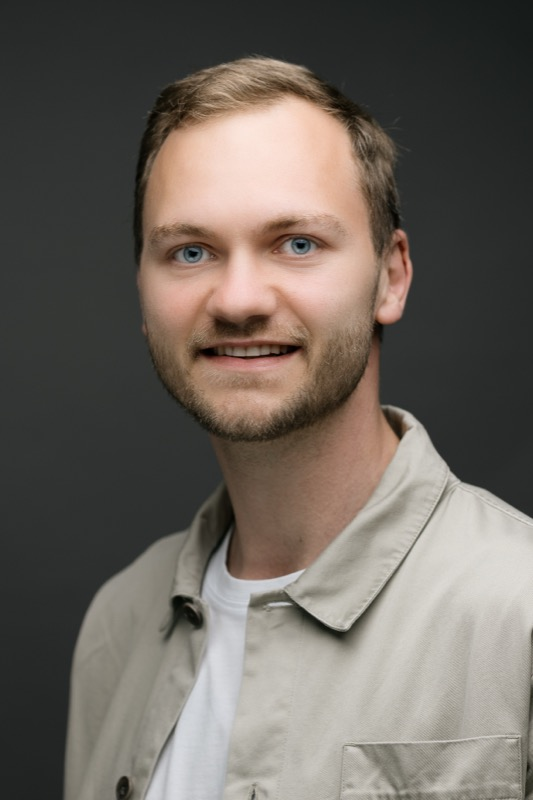

::: hero
::: hero-text
```{=html}
<p class="hero-name" role="heading" aria-level="1">Aske Halling</p>
```

<p class="tagline">Department of Political Science, Aarhus University</p>

I am an Assistant Professor at the [Department of Political Science](https://ps.au.dk) at Aarhus University. My research centers on a basic feature of the modern state: it constantly makes demands of its citizens — to document, to comply, to wait, and to prove they deserve help. I study these demands along three connected agendas: which demands citizens, frontline workers, and policymakers regard as legitimate; how the demands are experienced by the citizens who face them; and how fairly people are treated in citizen–state encounters.

I received my PhD from Aarhus University in 2023 and have published in journals such as *Public Administration Review*, *Journal of Public Administration Research and Theory*, and *Public Administration*. My work has been recognised with best paper awards at *Politica* (2024) and the ENPA Conference (2026).

::: social-links
[Email](mailto:aske@ps.au.dk)
[LinkedIn](https://www.linkedin.com/in/aske-halling-329195118/)
[Google Scholar](https://scholar.google.com/citations?user=AyPnunoAAAAJ&hl=en)
[CV (PDF)](files/cv.pdf)
:::

:::

::: hero-image

:::
:::

## Selected recent work

::: card-list

::: item
[[Beyond the Hassle: How Favorable Outcomes Reduce the Subjective Experience of Administrative Burden](https://doi.org/10.1080/10967494.2026.2696855)]{.title}

[with Frederik Godt · *International Public Management Journal*, 2026]{.meta}
:::

::: item
[[Taxing Language: Do Interpreting Fees Affect Immigrant Healthcare Usage? Evidence from a Regression Discontinuity Design](https://doi.org/10.1111/puar.13930)]{.title}

[*Public Administration Review*, 85(4): 1019–1037, 2025]{.meta}
:::

::: item
[[Acceptable or Not? Understanding Attitudes Toward Citizens' Discrimination Against Frontline Workers](https://doi.org/10.1111/padm.70037)]{.title}

[with Mathilde Cecchini and Benedicte Gronhoj · *Public Administration*, 104(3): 459–475, 2026]{.meta}
:::

:::

[All research →](research-legitimacy.qmd){style="display:inline-block; margin-top:1.25rem; font-family:'Source Sans 3',sans-serif; font-weight:600;"}
